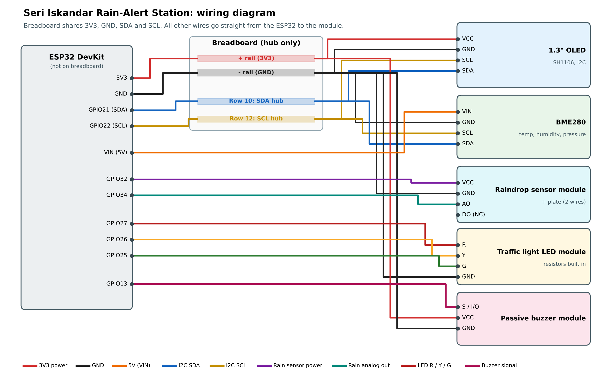

# Rain-Alert Station (Bonus Hardware)

A standalone ESP32 device that warns when rain is about to fall in Seri Iskandar.
It combines the Open-Meteo forecast with local sensors, and shows the alert on an
OLED screen, a traffic light and a buzzer. Code: [`rain_station/rain_station.ino`](rain_station/rain_station.ino)

## 1. What it does

| Condition | OLED | Traffic light | Buzzer |
|---|---|---|---|
| Rain sensor plate is wet | RAINING NOW | Red blinking | 3 beeps (once) |
| Forecast: chance ≥ 70% or ≥ 1.0 mm in next 3 h | RAIN LIKELY | Red | 3 beeps (once) |
| Forecast: chance ≥ 40% or ≥ 0.2 mm in next 3 h | RAIN POSSIBLE | Yellow | Silent |
| Otherwise | NO RAIN | Green | Silent |
| No Wi-Fi | Local rule: humidity ≥ 90% and pressure fell ≥ 1 hPa in 3 h → RAIN POSSIBLE | Same colours | Same |

- The forecast is checked every 10 minutes. The sensors are read every 5 seconds.
- The OLED also shows the next-3-hour forecast, temperature, humidity, pressure and how wet the plate is.
- The top-right corner of the OLED shows **ONLINE** (forecast received) or **LOCAL** (offline, using local sensors).
- The thresholds and location (4.36°N, 100.97°E) are the same as the web dashboard's rain banner.

## 2. Parts list

| Part | Used for | Price (RM) |
|---|---|---|
| ESP32 Development Board (Type-C) | Main controller, Wi-Fi | 20.95 |
| GY-BME280 (5V version) | Temperature, humidity, air pressure | 19.99 |
| 1.3" OLED display (I2C, SH1106) | Shows the alert and readings | 23.71 |
| Raindrop sensor module + plate | Detects rain falling now | 3.80 |
| Traffic light LED module | Green / yellow / red alert | 2.50 |
| Passive buzzer module | Audible alert | 2.50 |
| Breadboard 400 holes | Shared 3V3, GND, SDA, SCL | 2.70 |
| Jumper wires (male-female, male-male) | Connections | 6.50 |
| Jumper wires (female-female) | Direct ESP32-to-module connections | Owned |
| Resistors 51 Ω (20 pcs) | Not needed (LED module has built-in resistors) | 2.00 |
| **Total** | | **84.65** |

## 3. Wiring



The ESP32 is **not** placed on the breadboard (it is too wide for a 400-hole board).
The breadboard is only a hub that shares 3V3, GND, SDA and SCL between modules.

| Module | Module pin | Connect to | Wire |
|---|---|---|---|
| ESP32 | 3V3 | Breadboard **+ rail** | F-M |
| ESP32 | GND | Breadboard **− rail** | F-M |
| ESP32 | GPIO 21 | Breadboard **row 10** (SDA hub) | F-M |
| ESP32 | GPIO 22 | Breadboard **row 12** (SCL hub) | F-M |
| OLED | VCC | + rail | F-M |
| OLED | GND | − rail | F-M |
| OLED | SDA | Row 10 | F-M |
| OLED | SCL | Row 12 | F-M |
| BME280 | VIN | ESP32 **VIN** (5V) | F-F |
| BME280 | GND | − rail | F-M |
| BME280 | SDA | Row 10 | F-M |
| BME280 | SCL | Row 12 | F-M |
| Rain module | VCC | ESP32 **GPIO 32** | F-F |
| Rain module | GND | − rail | F-M |
| Rain module | AO | ESP32 **GPIO 34** | F-F |
| Rain module | DO | Not connected | |
| Rain plate | 2 pins | Rain module's 2-pin side (either way round) | Wires in the sensor bag |
| Traffic light | R | ESP32 **GPIO 27** | F-F |
| Traffic light | Y | ESP32 **GPIO 26** | F-F |
| Traffic light | G | ESP32 **GPIO 25** | F-F |
| Traffic light | GND | − rail | F-M |
| Passive buzzer | S (or I/O) | ESP32 **GPIO 13** | F-F |
| Passive buzzer | VCC (or +) | + rail | F-M |
| Passive buzzer | GND (or −) | − rail | F-M |

Design notes:
- The OLED and BME280 share one I2C bus (SDA 21, SCL 22). They have different addresses (OLED 0x3C, BME280 0x76 or 0x77), so they do not clash.
- The rain sensor is powered from GPIO 32 **only while it is being read**. This keeps its output at 3.3 V (safe for the ESP32) and slows corrosion of the plate.
- GPIO 34 is an ADC1 pin, so analog readings still work while Wi-Fi is on.
- The BME280 5V version has its own regulator, so it is powered from VIN (5V from USB).

## 4. Build steps

Unplug the USB cable while wiring.

1. **Breadboard rails.** Connect ESP32 **3V3** to the red **+** rail and ESP32 **GND** to the blue **−** rail.
2. **I2C hub.** Connect ESP32 **GPIO 21** to a hole in row 10 and **GPIO 22** to a hole in row 12. Each row of 5 holes is connected inside the breadboard.
3. **OLED.** VCC → + rail, GND → − rail, SDA → row 10, SCL → row 12.
4. **BME280.** VIN → ESP32 VIN, GND → − rail, SDA → row 10, SCL → row 12.
5. **Rain sensor.** Connect the plate to the small module with its 2 wires. Module VCC → GPIO 32, GND → − rail, AO → GPIO 34. Leave DO empty.
6. **Traffic light.** R → GPIO 27, Y → GPIO 26, G → GPIO 25, GND → − rail.
7. **Buzzer.** S → GPIO 13, VCC → + rail, GND → − rail.
8. **Check** every GND goes to the − rail and nothing touches the + and − rails at the same time.

## 5. Software setup and upload

1. Install the [Arduino IDE](https://www.arduino.cc/en/software).
2. **File → Preferences → Additional boards manager URLs**, paste:
   `https://espressif.github.io/arduino-esp32/package_esp32_index.json`
3. **Tools → Board → Boards Manager**, install **esp32 by Espressif Systems**.
4. **Tools → Manage Libraries**, install:
   - **U8g2** by oliver
   - **Adafruit BME280 Library** (click *Install all* to add Adafruit Unified Sensor)
   - **ArduinoJson** by Benoit Blanchon (version 7)
5. Open `rain_station/rain_station.ino` and set your Wi-Fi:
   ```cpp
   const char* WIFI_SSID = "YOUR_WIFI_NAME";
   const char* WIFI_PASS = "YOUR_WIFI_PASSWORD";
   ```
   Use a **phone hotspot on 2.4 GHz**. UTP Wi-Fi needs a username login, which the ESP32 cannot do.
6. **Tools → Board → esp32 → ESP32 Dev Module**, then **Tools → Port** → your COM port.
7. Click **Upload**. If it stays on "Connecting...", hold the **BOOT** button until uploading starts.
8. Open **Tools → Serial Monitor** at **115200** baud.

On power-up the station runs a self-test: green, yellow, red light up in turn, then one beep.
Then the OLED shows the alert, and the Serial Monitor prints a line every 5 seconds, for example:

```
Forecast next 3 h: max chance 69%, total 0.9 mm
T=29.4C H=82% P=1008.6hPa trend3h=nan rainRaw=4095 wet=0% -> RAIN POSSIBLE
```

(`trend3h` shows `nan` for the first 3 hours while the pressure history fills up.)

## 6. Calibrating the rain sensor

1. With the plate dry, note the `wet=` value in the Serial Monitor (usually 0 to 5%).
2. Drip a few drops of water on the plate and note the new `wet=` value.
3. Set `RAIN_WET_PERCENT` near the top of the code to a number between the two (default 30), and upload again.
4. Dry the plate after testing.

**Demo tip for the video:** drip water on the plate to show RAINING NOW (red blinking + beeps), then wipe it dry to return to the forecast-based colour.

## 7. Troubleshooting

| Problem | Fix |
|---|---|
| No COM port appears | Use a USB cable that carries data. Install the CH340 or CP210x driver (check the chip on the board). |
| OLED blank | Check VCC/GND, and that SDA is on row 10 and SCL on row 12. |
| OLED shows noise or the picture is shifted | Your OLED uses the SSD1306 chip. Swap the `U8G2_SH1106...` line for the `U8G2_SSD1306...` line in the comment above it. |
| "BME280 not found" | Check SDA/SCL. If it still fails, the board may be a BMP280 (no humidity). |
| OLED shows LOCAL / "no forecast" | Wi-Fi failed. Check the hotspot name, password and 2.4 GHz setting. |
| Wrong LED lights up | Swap the R/Y/G wires so they match GPIO 27 / 26 / 25. |
| Buzzer silent | Check S is on GPIO 13. Some modules label the signal pin **I/O**. |
| Plate always WET | The plate is still damp, or `RAIN_WET_PERCENT` is too low. |

## 8. How it links to the cloud system

| | Cloud system (GitHub Actions + dashboard) | Rain-alert station (ESP32) |
|---|---|---|
| Data source | Open-Meteo forecast API | Open-Meteo forecast API + BME280 + raindrop sensor |
| Location | 4.36°N, 100.97°E | 4.36°N, 100.97°E |
| Update rate | Every 30 min | Forecast every 10 min, sensors every 5 s |
| Rain rule | ≥ 70% or ≥ 1.0 mm = red, ≥ 40% or ≥ 0.2 mm = amber | Same rule, plus RAINING NOW from the plate |
| Works without internet | No | Yes (local humidity + pressure rule) |
| Output | Web dashboard, accuracy analysis | OLED, traffic light, buzzer |
