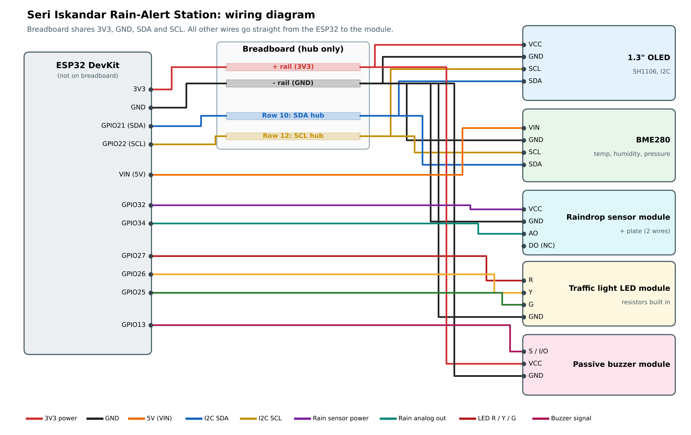
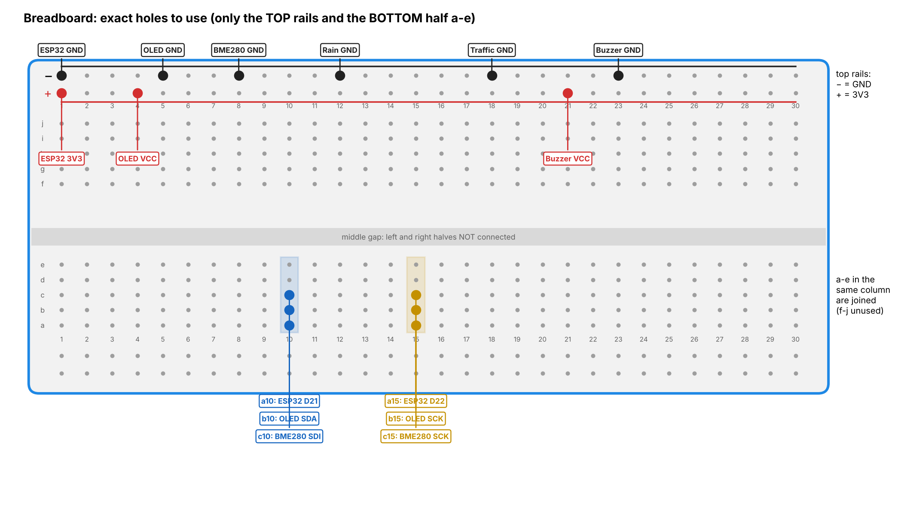

# Rain-Alert Station (Bonus Hardware)

A standalone ESP32 device that warns people on site when rain is coming in Seri Iskandar.
It combines the Open-Meteo forecast with local sensors and shows the alert on an OLED
screen, a traffic light and a buzzer. It keeps working without internet using a local rule.

Code: [`rain_station/rain_station.ino`](rain_station/rain_station.ino)

## 1. What it does

| Condition | OLED | Traffic light | Buzzer |
|---|---|---|---|
| Rain sensor plate is wet | RAINING NOW | Red blinking | 3 beeps (once) |
| Forecast: chance ≥ 70% or ≥ 1.0 mm in next 3 h | RAIN LIKELY | Red | 3 beeps (once) |
| Forecast: chance ≥ 40% or ≥ 0.2 mm in next 3 h | RAIN POSSIBLE | Yellow | Silent |
| Otherwise | NO RAIN | Green | Silent |
| No Wi-Fi | Local rule: humidity ≥ 90% and pressure fell ≥ 1 hPa in 3 h → RAIN POSSIBLE | Same colours | Same |

- Sensors are read every 5 seconds; the forecast is downloaded every 10 minutes.
- The OLED also shows the next-3-hour forecast, temperature, humidity, pressure and how wet the plate is.
- Top-right of the OLED: **ONLINE** (forecast received) or **LOCAL** (offline, local rule).
- Thresholds and location (4.36°N, 100.97°E) are the same as the dashboard's rain banner.

## 2. Parts list

| Part | Used for | Price (RM) |
|---|---|---|
| ESP32 development board (Type-C) | Main controller, Wi-Fi | 20.95 |
| GY-BME280 (5V version) | Temperature, humidity, air pressure (I2C) | 19.99 |
| 1.3" OLED display (I2C, SH1106) | Shows the alert and readings | 23.71 |
| Raindrop sensor (plate + module) | Detects rain falling now | 3.80 |
| Traffic light LED module | Green / yellow / red alert (resistors built in) | 2.50 |
| Passive buzzer module | Audible alert | 2.50 |
| Breadboard, 400 holes | Shared 3V3, GND, SDA, SCL | 2.70 |
| Jumper wires | Connections | 6.50 |
| Resistors 51 Ω | Spare (not needed) | 2.00 |
| **Total** | | **84.65** |

## 3. Wiring



The ESP32 is **not** on the breadboard. The breadboard is only a hub for 3V3, GND, SDA and SCL.
Use only the **top** + and − rails and the bottom half (rows a to e). Holes a–e in the same column
are connected.



### ESP32 to breadboard
| ESP32 pin | Breadboard hole |
|---|---|
| 3V3 | + rail |
| GND | − rail |
| D21 (SDA) | a10 |
| D22 (SCL) | a15 |

### Modules
| Module | Pin | Goes to |
|---|---|---|
| OLED | VCC | + rail |
| OLED | GND | − rail |
| OLED | SDA | b10 |
| OLED | SCK (= SCL) | b15 |
| BME280 | VIN | **ESP32 VIN (5V)** |
| BME280 | GND | − rail |
| BME280 | SDI (= SDA) | c10 |
| BME280 | SCK (= SCL) | c15 |
| BME280 | 3Vo, SDO, CS | Not connected (keeps I2C mode) |
| Rain plate | 2 pins | Rain module's 2-pin side (either way round) |
| Rain module | VCC | ESP32 D32 |
| Rain module | GND | − rail |
| Rain module | AO | ESP32 D34 |
| Rain module | DO | Not connected |
| Traffic light | R / Y / G | ESP32 D27 / D26 / D25 |
| Traffic light | GND | − rail |
| Passive buzzer | S (or I/O) | ESP32 D13 |
| Passive buzzer | VCC / GND | + rail / − rail |

**Check before power-on:** **3** wires on the + rail (ESP32 3V3, OLED, buzzer), **6** wires on the − rail, **3** wires each in columns 10 and 15. Nothing on the bottom rails or rows f–j.

### Wires used
22 connections: 9 female-male, 7 female-female (ESP32 straight to module), and 6 joined
female-female + male-male pairs (a joined pair works as a female-male wire). Tape the joints.

### Design notes
- OLED (0x3C) and BME280 (0x76) share one I2C bus; their addresses are different, so they do not clash.
- The I2C bus runs at **100 kHz** for reliability over long jumper wires.
- The rain sensor is powered from D32 **only while reading**, which keeps its output at 3.3 V and slows corrosion of the plate.
- D34 is an ADC1 pin, so analog reading works while Wi-Fi is on.
- This BME280 is the **5V version** (it has its own regulator), so it must be powered from VIN, not 3V3.

## 4. Software

1. Install the Arduino IDE.
2. **File → Preferences → Additional boards manager URLs:**
   `https://espressif.github.io/arduino-esp32/package_esp32_index.json`
3. **Boards Manager:** install **esp32 by Espressif Systems**.
4. **Library Manager:** install **U8g2** (oliver), **Adafruit BME280 Library** (click *Install all*), **ArduinoJson** (Benoit Blanchon, v7).
5. In `rain_station.ino`, set `WIFI_SSID` and `WIFI_PASS`. Use a **2.4 GHz phone hotspot**
   (UTP Wi-Fi needs a login the ESP32 cannot do). Do not commit your real password.
6. **Board:** ESP32 Dev Module, then pick the COM port and click Upload
   (hold **BOOT** if it stays on "Connecting...").
7. **Serial Monitor:** 115200 baud.

On power-up: green → yellow → red self-test, one beep, then the OLED shows the alert.
The Serial Monitor prints a line every 5 s, for example:

```
T=29.4C H=82% P=1008.6hPa trend3h=nan rainRaw=4095 wet=0% -> RAIN POSSIBLE
```

`trend3h` shows `nan` for the first 3 hours while the pressure history fills up.

### Quick I2C test
Before the main code, upload a simple I2C scanner. You should see `0x3C` (OLED) and `0x76` or `0x77` (BME280).

## 5. Calibrating the rain sensor

1. Dry plate: note the `wet=` value (usually 0–5%).
2. Drip water across several lines of the plate and note the new `wet=` value.
3. Set `RAIN_WET_PERCENT` (default 30) between the two values and upload again.

Demo: spread water over the plate to show RAINING NOW (red blinking + beeps), then wipe it dry.

## 6. Troubleshooting

| Problem | Fix |
|---|---|
| No COM port | Use a data USB cable; install the CH340 or CP210x driver. |
| OLED blank | Check VCC/GND and that SDA is in column 10, SCK in column 15. |
| OLED noisy or shifted | Swap the `U8G2_SH1106...` line for the `U8G2_SSD1306...` line in the comment. |
| "BME280 not found" | A wire was loose at start-up. Push VIN/GND/SDI/SCK in firmly (joined wires slip), check the header pins are soldered, then press **EN**. Keep VIN on the ESP32 VIN pin. |
| Impossible readings (e.g. 178 °C, −102 hPa) | The BME280 lost power for a moment; reseat its wires and press EN. |
| OLED shows LOCAL | Wi-Fi failed: check hotspot name, password and 2.4 GHz. |
| RAINING NOW flickers | Plate is only slightly wet; spread more water or lower `RAIN_WET_PERCENT`. |
| Wrong LED lights | Swap the R/Y/G wires to match D27/D26/D25. |
| Buzzer silent | Check S is on D13 (some modules label it I/O). |

## 7. Link to the cloud system

| | Cloud system | Rain-alert station |
|---|---|---|
| Data source | Open-Meteo forecast API | Open-Meteo + BME280 + raindrop sensor |
| Location | 4.36°N, 100.97°E | 4.36°N, 100.97°E |
| Update rate | Scheduled every 30 min | Forecast every 10 min, sensors every 5 s |
| Rain rule | ≥ 70% or ≥ 1.0 mm = red; ≥ 40% or ≥ 0.2 mm = amber | Same, plus RAINING NOW from the plate |
| Works offline | No | Yes (local humidity + pressure rule) |
| Output | Web dashboard, accuracy analysis | OLED, traffic light, buzzer |
